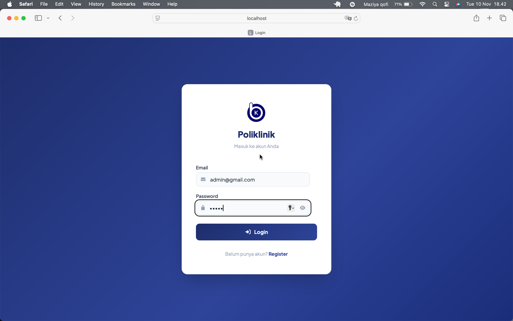
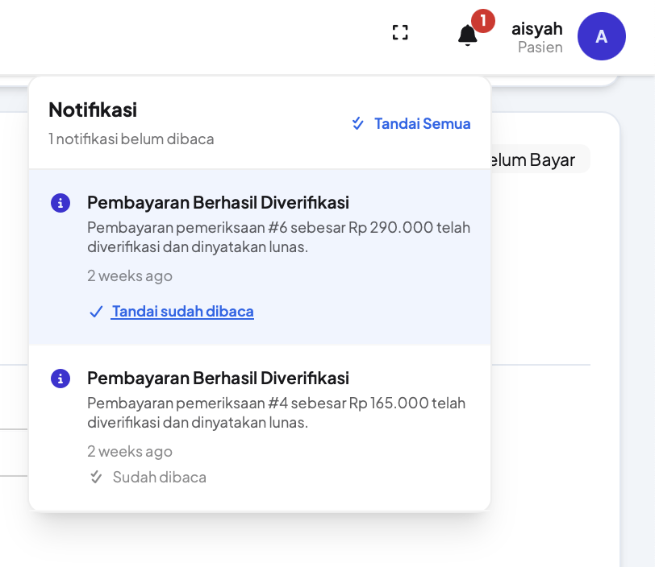

# GitHub Quiz

## Student Information

**Name:** Maziya Ats Tsaqofi  
**Student ID:** A11.2023.15501  
**Class:** DEV-01  
**Course:** Bengkel Coding  

## Description

This repository was created to fulfill the GitHub practice assignment for the Bengkel Coding course. It also contains the Laravel Polyclinic project developed as part of the Bengkel Coding learning activities.

The project is used to practice Laravel development, database management, authentication, multi-user roles, routing, models, migrations, and other web development concepts.

# Poliklinik App

Aplikasi manajemen poliklinik berbasis web yang dikembangkan menggunakan
Laravel. Aplikasi ini menyediakan alur pengelolaan layanan poliklinik
untuk tiga jenis pengguna: **Admin**, **Dokter**, dan **Pasien**.

## Daftar Isi

-   [Tentang Proyek](#tentang-proyek)
-   [Peran dan Fitur](#peran-dan-fitur)
-   [Teknologi](#teknologi)
-   [Tangkapan Layar](#tangkapan-layar)
-   [Persiapan dan Instalasi](#persiapan-dan-instalasi)
-   [Menjalankan Aplikasi](#menjalankan-aplikasi)
-   [Catatan Pengembangan](#catatan-pengembangan)

## Tentang Proyek

**Poliklinik App** merupakan aplikasi web untuk membantu proses
administrasi dan pelayanan poliklinik. Fitur aplikasi disusun
berdasarkan hak akses pengguna sehingga setiap peran memiliki halaman
dan fungsi yang sesuai.

## Peran dan Fitur

### Admin

-   Melihat dan mengelola data pasien.
-   Mengelola data dokter.
-   Mengelola data poli.
-   Mengelola data obat.
-   Mengelola pembayaran dan melihat detail pembayaran.

### Dokter

-   Melihat dan mengelola antrean pasien.
-   Memulai pelayanan dan melakukan pemeriksaan pasien.
-   Melihat jadwal praktik dokter.

### Pasien

-   Melakukan pendaftaran poli.
-   Melihat informasi antrean aktif.
-   Melihat riwayat dan detail pemeriksaan.
-   Mengakses halaman pembayaran.
-   Melihat notifikasi.

> Catatan: daftar di atas menggambarkan fitur yang didokumentasikan
> melalui tangkapan layar proyek. Detail implementasi dan ketersediaan
> setiap fitur mengikuti versi aplikasi pada repository.

## Teknologi

-   **PHP dan Laravel** --- framework dan sisi backend aplikasi.
-   **MySQL** --- basis data relasional.
-   **JavaScript, CSS, dan Vite** --- kebutuhan aset frontend dan proses
    pengembangan antarmuka.
-   **Laravel Reverb dan Laravel Echo** --- infrastruktur komunikasi
    real-time untuk pembaruan antrean.

## Tangkapan Layar

Seluruh gambar berikut disimpan di folder `public/images/screnshoots/`.
Path menggunakan path relatif repository agar gambar dapat ditampilkan
pada halaman GitHub.

### Halaman Umum

**Login**



### Halaman Pasien

**Pendaftaran poli**


**Antrean aktif**


**Riwayat pendaftaran dan status**


**Detail riwayat pemeriksaan**


**Pembayaran**


**Notifikasi**



### Halaman Dokter

**Manajemen antrean**


**Halaman pemeriksaan**


**Jadwal praktik dokter**


### Halaman Admin

**Data pasien**


**Manajemen dokter**


**Manajemen poli**


**Data obat**


**Manajemen pembayaran**


**Detail pembayaran**


## Persiapan dan Instalasi

Pastikan perangkat pengembangan telah memiliki PHP yang kompatibel
dengan versi Laravel pada proyek, Composer, Node.js dan npm, MySQL,
serta Git.

### 1. Clone repository

``` bash
git clone https://github.com/maziyaqofi/quiz-github-A11202315501.git
cd quiz-github-A11202315501
```

### 2. Install dependency backend

``` bash
composer install
```

### 3. Siapkan file environment

``` bash
cp .env.example .env
php artisan key:generate
```

Sesuaikan konfigurasi database pada file `.env`, terutama `DB_DATABASE`,
`DB_USERNAME`, dan `DB_PASSWORD`.

### 4. Jalankan migration

``` bash
php artisan migrate
```

Jika proyek menyediakan seeder dan memang diperlukan untuk mengisi data
awal, jalankan:

``` bash
php artisan db:seed
```

### 5. Install dependency frontend

``` bash
npm install
```

## Menjalankan Aplikasi

Untuk pengembangan lokal, jalankan proses-proses berikut pada terminal
terpisah dari direktori proyek.

**Terminal 1 --- Laravel development server**

``` bash
php artisan serve
```

**Terminal 2 --- Laravel Reverb**

``` bash
php artisan reverb:start --debug
```

**Terminal 3 --- Vite development server**

``` bash
npm run dev
```

**Terminal 4 --- Laravel scheduler**

``` bash
php artisan schedule:work
```

Buka alamat lokal yang ditampilkan oleh `php artisan serve` pada
browser. Proses Reverb diperlukan untuk fitur komunikasi real-time,
sedangkan scheduler menjalankan tugas terjadwal selama prosesnya aktif.

## Catatan Pengembangan

-   Pastikan konfigurasi database pada `.env` sesuai dengan MySQL lokal.
-   Jangan mengunggah file `.env`, kredensial, password, atau data
    pasien yang bersifat pribadi ke repository.
-   Gunakan data dummy saat mengambil tangkapan layar untuk dokumentasi.
-   Folder screenshot perlu disertakan dalam commit agar gambar pada
    README dapat tampil di GitHub.
-   Untuk lingkungan produksi, proses server, WebSocket, aset frontend,
    dan scheduler perlu dikonfigurasi sesuai lingkungan deployment;
    perintah di atas ditujukan untuk pengembangan lokal.
